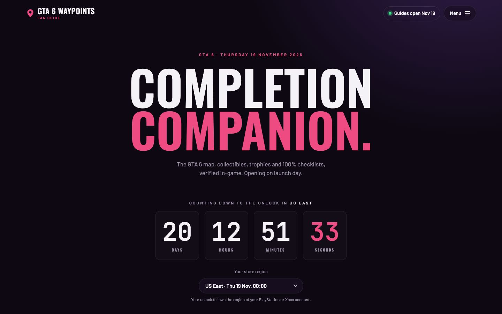
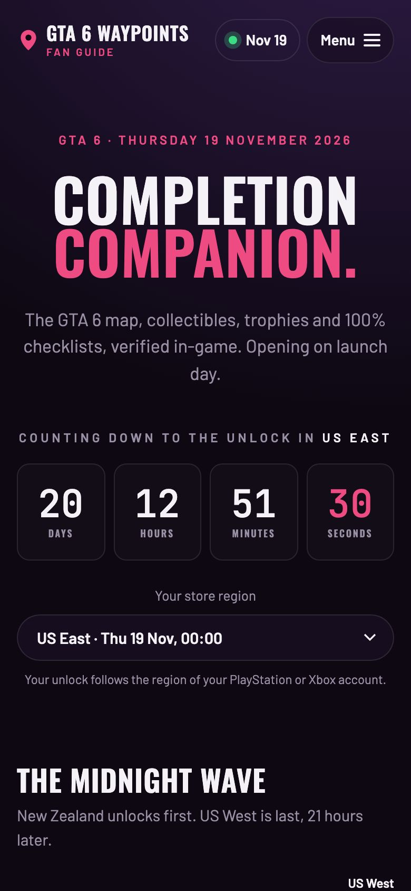
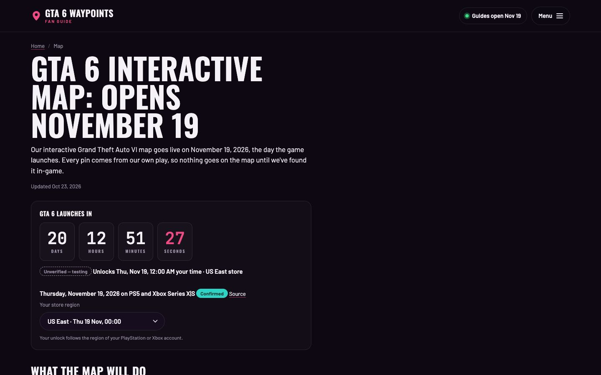
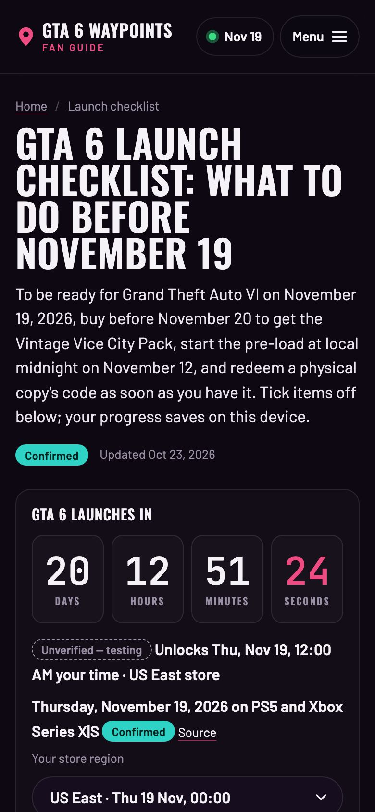

# GTA 6 Waypoints

**GTA 6 Waypoints — a fan-made completion companion for Grand Theft Auto VI. A passion project by Lincoln Greseth.**

Live site: **[gta6waypoints.com](https://gta6waypoints.com)**

<p>
  
  
</p>
<p>
  
  
</p>

## What it does today

GTA 6 launches on November 19, 2026. Until then the site is a launch-week hub. The map, collectibles, trophies and 100% pages are live as "opens on launch day" pages, and the guides behind them get written once things are verified in-game.

- **Live countdown to your unlock.** Counts down to midnight in the viewer's PlayStation/Xbox store region, across 15 regions. It picks the region from the viewer's time zone and remembers their choice. A "midnight wave" chart shows the unlock rolling from New Zealand to US West. Times are labelled Unverified until Rockstar or the stores publish them.
- **Embeddable countdown widget and OBS overlay.** `/embed/countdown/` (themes and sizes set by query string) and a transparent 1920×1080 `/embed/obs/` page for streamers. Each is a standalone page under 15 KB with no analytics.
- **Launch checklist** with tick boxes that save on the viewer's device.
- **Everything Confirmed**: one living page of official facts. Every line has a status badge and a source link.
- **News**, FAQ, editions comparison, characters, locations, PC-release tracker, and a release-date page with a per-region unlock table.
- **Add to calendar** (`.ics` for pre-load and launch day) and share buttons.
- **Unlock-alert email signup** with a region picker. It posts to Brevo when configured and falls back to Netlify Forms.
- **Affiliate links done properly**: a shortcode adds `rel="sponsored nofollow"`, a visible "(paid link)" label and the disclosure. Unapproved programs render as plain text.
- **Privacy-first analytics**: GA4 with Consent Mode v2 defaults set before the tag, denied in the EEA, UK and Switzerland until consent is given.
- **SEO plumbing**: BreadcrumbList, Article/NewsArticle and FAQPage JSON-LD, generated sitemap and robots.txt, Open Graph images, and clean URLs.

## Stack

- [Eleventy 3](https://www.11ty.dev/) with Nunjucks templates and Markdown content
- Vanilla JS and CSS (no framework); JS is minified with Terser at build time
- Self-hosted woff2 fonts
- [Netlify](https://www.netlify.com/) for hosting, deploy previews and form fallback
- [Brevo](https://www.brevo.com/) for the email list

## How it's built

**Content pipeline.** One input produces up to three outputs: a site update, short-form video scripts, and an email if it's big news. Before launch, sources are Rockstar's Newswire, Take-Two investor releases, the PlayStation and Xbox store listings, and established outlets. After launch, everything comes from my own play. Each find goes into a findings log with where, how and a clip, and gets published once it's verified. The plans are in [`docs/`](docs/) and the working files are in [`content-ops/`](content-ops/).

**Every claim is labelled.** A `` shortcode marks each fact:

| Label | Meaning |
|---|---|
| **Confirmed** | Rockstar, Take-Two, a platform store or a ratings board said it, or I verified it in-game |
| **Reported** | An established outlet reported it; the outlet is named and linked |
| **Rumor** | Leakers or social posts, only when they're the story |
| **Unverified** | Not confirmed yet, or still being tested in-game |

An unknown label fails the build on purpose. The site never publishes, links to or describes leaked material.

**Guardrails in code.** `npm run check` runs after every build and fails if a page breaks the rules: title and description length, `updated:` date, status badge, affiliate disclosure, the footer disclaimer, one H1, valid JSON-LD, FAQ markup matching the visible questions, at most four badges on the home page, and every menu link pointing at a page that exists. A second check validates the 15 unlock regions and their UTC offsets.

**Built with Claude Code.** I designed and directed the site and wrote the specs. [Claude Code](https://claude.com/claude-code) did most of the implementation, working from [`CLAUDE.md`](CLAUDE.md) and the saved prompts in [`content-ops/prompts/`](content-ops/prompts/).

## Run it locally

Requires Node 18 or later.

```bash
npm install
npm run dev     # local server with live reload
npm run build   # build to _site/
npm run check   # page and unlock-time checks; run after every build
```

Email signups work without any setup (they fall back to Netlify Forms). To post to Brevo instead, copy `.env.example` to `.env` and set `BREVO_FORM_ACTION`.

## License

The code is under the [MIT License](LICENSE).

### Content & assets

- The guides, written content and my gameplay screenshots are © Lincoln Greseth. All rights reserved.
- Barlow, Oswald and JetBrains Mono are under the [SIL Open Font License 1.1](src/assets/fonts/LICENSE.txt).
- Grand Theft Auto and related marks belong to Take-Two Interactive.

## Disclaimer

Unofficial fan site. Not affiliated with or endorsed by Rockstar Games or Take-Two Interactive. Grand Theft Auto and related marks are trademarks of Take-Two Interactive.
